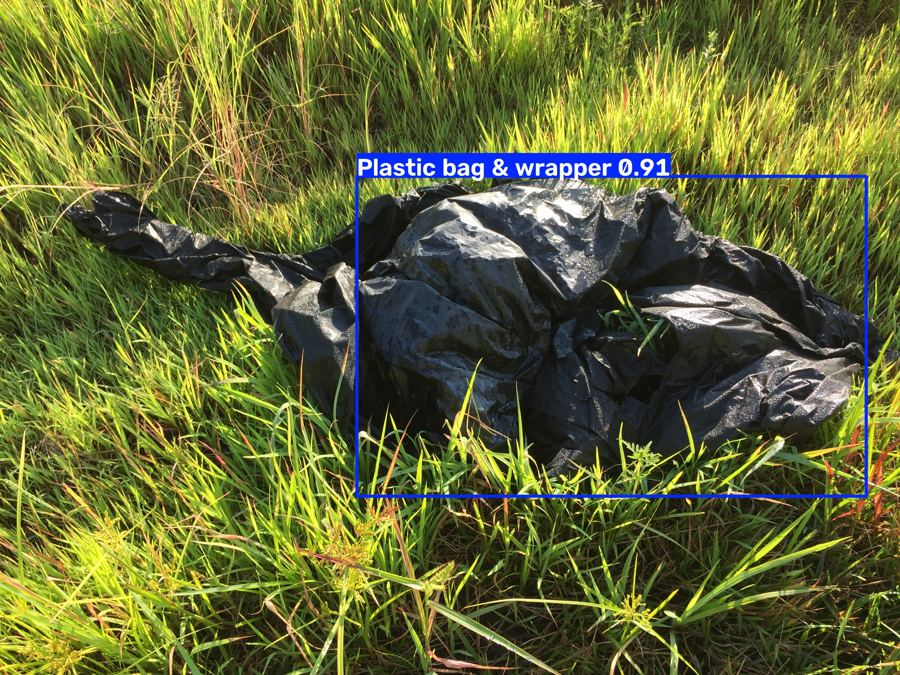
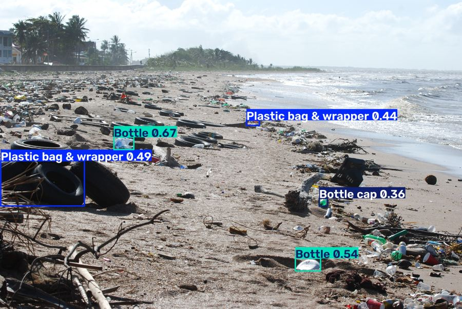
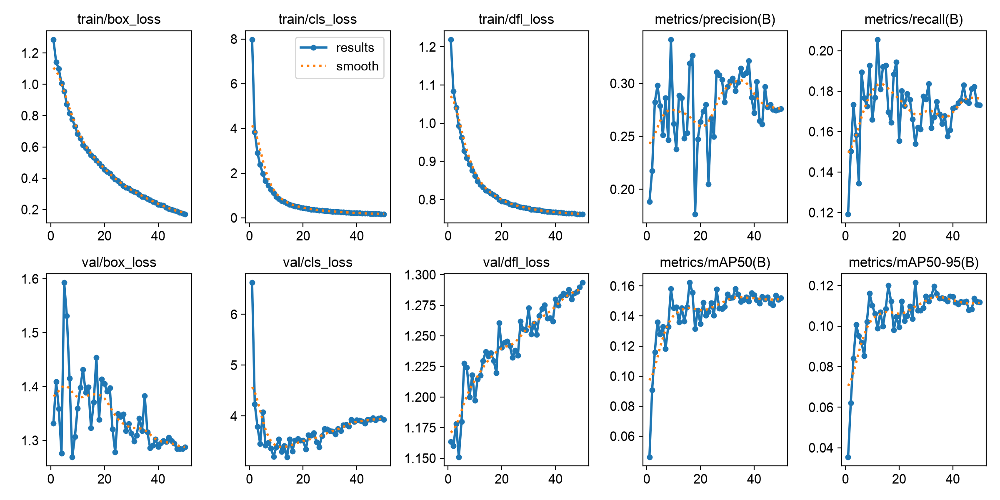

# Waste Detection CNN

Fine-tuning a lightweight CNN object detector (YOLO11n) to find litter in outdoor scenes, using the TACO dataset. Built end to end: real dataset audit, a documented class-taxonomy and split decision, an actual training run, a locked test-set evaluation, and a qualitative check against images the model had never seen from any source.

This started as a CSCI 441/541 (Neural Network and Deep Learning) research assignment at St. Cloud State University. It's kept here in full because the process, not just the result, is worth showing: every phase is gated, every decision is logged, and every number in this README is pulled from a committed artifact, not estimated.

## Showcase

| Correctly detected, never seen during training | Dense beach scene, far more cluttered than training data |
| --- | --- |
|  |  |



## What it does

- Downloads and audits the real [TACO](http://tacodataset.org/) dataset (1,500 images, 4,784 annotations, 60 raw categories), computing every statistic directly from the data rather than trusting published figures.
- Collapses the 60 sparse raw categories into an 18-class taxonomy (17 supercategories with at least 50 instances, plus a catch-all), built from measured frequencies, not a guess.
- Splits the data 70/15/15 with a leakage check (every image file hashed for duplicates) and converts COCO annotations to YOLO format with its own correctness tests.
- Fine-tunes YOLO11n (pretrained on COCO) on the result: 50 epochs, Apple M1 Pro, PyTorch MPS, no training-time augmentation, so the baseline is clean.
- Evaluates once on a locked test split (mAP@0.5 = 0.129) and once on five genuinely external images pulled from Wikimedia Commons, not TACO, to see how it holds up outside its own dataset.
- Documents the honest result: it works on TACO-like scenes and has a specific, repeatable blind spot for small, low-contrast objects (cigarettes, the single largest class by instance count, are almost never detected).

## Results

| Metric | Validation | Locked test |
|---|---:|---:|
| Precision | 0.312 | 0.272 |
| Recall | 0.154 | 0.177 |
| mAP@0.5 | 0.158 | 0.129 |
| mAP@0.5:0.95 | 0.122 | 0.097 |

Full per-class breakdown, the external-image results, and the error analysis are in [`docs/phase5_results.md`](docs/phase5_results.md) and the final report, [`report/REPORT.md`](report/REPORT.md).

## Quick start

```bash
git clone https://github.com/Yohanes-Mk/waste-detection-cnn.git
cd waste-detection-cnn
python3 -m venv .venv && source .venv/bin/activate
pip install -r requirements.txt ultralytics

bash scripts/download_taco.sh       # official TACO v1.0 from Zenodo, CC-BY-4.0
python scripts/audit_dataset.py     # real counts, dimensions, class balance -> outputs/dataset_audit.json
python scripts/prepare_dataset.py   # taxonomy + split + COCO->YOLO conversion -> configs/dataset.yaml
python scripts/test_coord_conversion.py   # correctness tests, should all pass
python scripts/train.py --exp E0 --epochs 50 --batch 16
python scripts/evaluate.py          # locked test-set metrics -> outputs/test_metrics.json
python scripts/predict.py           # inference on data/unseen_external/
```

A pre-trained checkpoint from the run described above is already committed at `experiments/E0_baseline/weights/best.pt`, so `evaluate.py` and `predict.py` work without retraining.

## Repository map

```
README.md                this file
PRD.md                    the original planning document this project worked from
scripts/                  everything runnable: download, audit, prepare, train, evaluate, predict, tests
configs/dataset.yaml      the generated Ultralytics dataset config this run used
data/                     dataset provenance, license notes, split manifests (raw images gitignored)
experiments/              the actual training run: curves, logs, checkpoints, test-set evaluation
outputs/                  machine-readable results (dataset_audit.json, test_metrics.json)
report/                   the submitted report (.docx and .md), code-only zip, figures
docs/                     phase-by-phase process log: literature scan, decisions, model selection,
                          results write-ups for each phase, kept because the process is the point
```

## Process, not just output

Every phase (research question, dataset, preprocessing, model selection, baseline training, evaluation, report) has its own gate and its own evidence trail in `docs/`. A few things worth pointing at directly:

- [`docs/literature_notes.md`](docs/literature_notes.md): a short literature scan that caught its own research question being too close to a one-click tutorial, and narrowed it before any code was written.
- [`docs/decisions.md`](docs/decisions.md): a running decision log, including a mistake I caught and fixed myself (an early class-taxonomy count was wrong by one category) before it reached the final report.
- [`docs/phase3_model_selection.md`](docs/phase3_model_selection.md): why YOLO11n was chosen over a Faster R-CNN alternative, compared on paper before either was implemented.

## Scope note

This is a baseline detector, trained once, on one dataset, without a second (augmented) experiment to compare against. It demonstrates that a lightweight CNN can be fine-tuned on a small, imbalanced, real-world dataset and evaluated honestly, including on data the model never saw during training. It does not claim state-of-the-art accuracy, a production-ready detector, or a deployed robotic system; the original motivating use case (an autonomous litter-collection robot) is a framing device for the problem, not something built or claimed here.

## License

MIT. See [LICENSE](LICENSE). The TACO dataset itself is licensed CC-BY-4.0 by its own authors; see `data/README.md` for attribution details.
