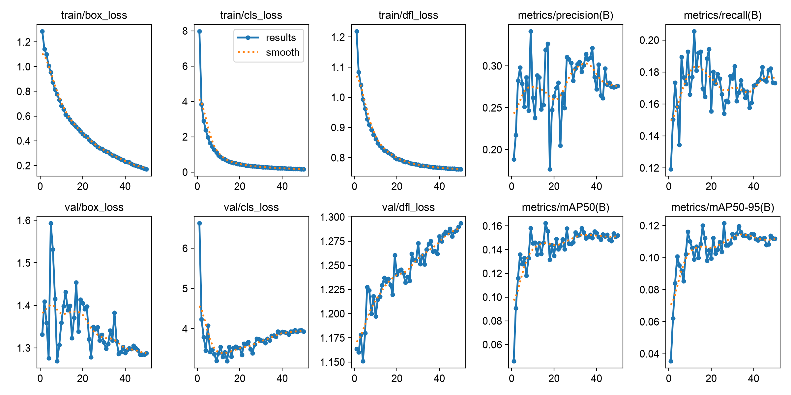
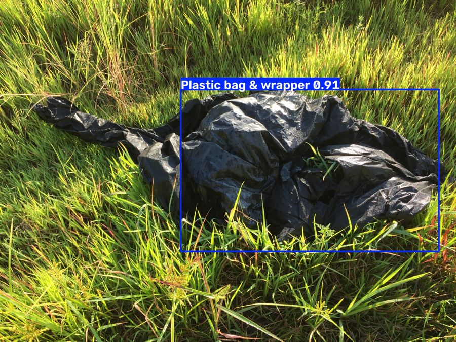

# Vision-Based Waste Detection: Fine-Tuning a CNN Detector on TACO

**Markdown source of truth.** Final submission file is `report/Yohannes_Nigusse_Research_Assignment.docx` (same content). All numbers below are real, logged results from this repository (`docs/phase3_results.md`, `docs/phase5_results.md`, `outputs/`).

CSCI 441/541 Research Assignment, 10 points · Yohannes Nigusse

---

## a. Domain

For this assignment I worked in the domain of outdoor litter and waste detection. That means finding and localizing discarded trash (bottles, bags, cans, cigarette butts, and similar items) in photos of real-world outdoor scenes like streets, parks, and beaches. The bigger motivation behind this is an autonomous cleanup robot, which would need to visually spot litter before it could ever navigate to it or pick it up. This project only covers that first visual step. I didn't build or simulate any robot, navigation, or pickup mechanism. I only worked on the perception piece, which is what the assignment is actually asking for.

## b. Research focus and reasoning

I chose object detection as the research focus, meaning I drew a bounding box around each litter item and labeled it, rather than classification or segmentation.

Classification alone would only tell you whether an image contains litter somewhere, not where. That's not enough for the kind of per-object analysis this report does, and it wouldn't be useful for the robot use case either, since a robot needs a location to navigate to, not just a yes/no answer. Segmentation was the other option (TACO actually does include pixel-level masks), but a full segmentation model is harder to evaluate cleanly within this assignment's scope, and pixel-perfect boundaries aren't needed for the kind of localization this project cares about. Object detection sits in the middle: it tells you where each object is without requiring exact pixel boundaries, and it lines up directly with the bounding-box annotations TACO already provides.

Before locking this in, I did a short literature scan (five sources, listed in the References section and summarized in `docs/literature_notes.md`) to check that the task wasn't just a one-click tutorial exercise. TACO's own paper (Proenca and Simoes, 2020) reports baseline instance-segmentation results, and more recent work from 2024 to 2025 applies YOLO-family detectors to litter and garbage detection, including on hardware similar to what I used here. That confirmed the task is real and still active, but it also showed that fine-tuning YOLO on TACO by itself is a fairly well-trodden combination. Ultralytics even hosts TACO as a one-click dataset on their own platform. Because of that, I framed this report around evaluating how well a baseline detector actually performs on this dataset and identifying, with evidence, where it struggles, rather than trying to prove a broader claim in a single pass.

The dataset's own documented class imbalance, described in the next section, also raised an obvious follow-up question: whether training-time augmentation would help close the gap on the weakest, lowest-support categories specifically. I did not test that question in this report. It's a direction the baseline results in section e point toward, not a claim I'm making here.

## c. Dataset description

I used TACO (Trash Annotations in Context), version 1.0, downloaded directly from its official Zenodo archive (DOI 10.5281/zenodo.3587843), licensed CC-BY-4.0. All the numbers below are real counts I computed directly from the downloaded annotation file, not estimates from the dataset's website.

| Property | Value |
|---|---|
| Images | 1,500 |
| Annotations (bounding boxes) | 4,784 |
| Raw annotated categories | 60 |
| Image width (min / median / max) | 842 / 2,448 / 6,000 px |
| Image height (min / median / max) | 474 / 3,264 / 5,312 px |
| Missing/corrupt image files | 0 |

The class distribution is heavily imbalanced, and that shaped how I prepared the data. The most common raw category, "Cigarette," has 667 instances, while 10 of the 60 raw categories have 5 or fewer instances each. Training a 60-way head on that would leave most classes with almost nothing to learn from, so I collapsed the 60 raw categories down to their 17 supercategories that have at least 50 instances, plus one catch-all "other_litter" class for everything rarer, 18 classes total: Plastic bag & wrapper (850), Cigarette (667), Unlabeled litter (517), Bottle (439), Bottle cap (289), Can (273), Other plastic (273), Carton (251), Cup (192), Straw (161), Paper (148), Broken glass (138), Styrofoam piece (112), Pop tab (99), Lid (87), Plastic container (72), Aluminium foil (62), and other_litter.

I split the data 70/15/15 into train, validation, and test sets by random image ID with a fixed seed, giving 1,050 / 225 / 225 images and 3,385 / 712 / 680 boxes (7 of the original 4,784 boxes were dropped during conversion for being zero-area or out of bounds). Before splitting, I hashed every image file to check for duplicates across the dataset and found none, so a random split was reasonable here. I didn't need to worry about the same physical scene leaking across splits. The test split was not touched again until the final evaluation in section e.

## d. CNN training technique and code

I used YOLO11n (Ultralytics), a convolutional detector pretrained on COCO, and fine-tuned it on the 18-class TACO taxonomy described above. I picked it over a Faster R-CNN alternative after comparing the two on paper: YOLO11n has built-in augmentation controls (useful for isolating exactly one variable later), it's a direct application of the CNN-backbone-plus-transfer-learning approach this course covers, and it fit comfortably in the compute and time I had available.

Architecturally, it's a single-stage, anchor-free detector: a CNN backbone (built from C3k2 convolutional blocks) extracts features, a C2PSA attention block refines them, and a decoupled detection head predicts a class and a bounding box per location directly, with no separate region-proposal stage. Since COCO's 80 pretrained classes don't include litter-specific categories, I fine-tuned the entire network rather than freezing the backbone, so the detection head could actually learn the new classes.

I trained for 50 epochs, batch size 16, image size 640x640, with a fixed seed (441), on my own machine (Apple M1 Pro, 16GB RAM) using PyTorch's MPS backend. I deliberately turned off every training-time augmentation option (no color jitter, flips, rotation, scaling, mosaic, or mixup) so this run would be a clean, unmodified baseline:

```python
# scripts/train.py (excerpt)
E0_HYPERPARAMS = dict(
    hsv_h=0.0, hsv_s=0.0, hsv_v=0.0,
    degrees=0.0, translate=0.0, scale=0.0, shear=0.0, perspective=0.0,
    flipud=0.0, fliplr=0.0,
    mosaic=0.0, mixup=0.0, copy_paste=0.0, erasing=0.0,
    auto_augment=None,
)

model = YOLO("yolo11n.pt")
model.train(
    data="configs/dataset.yaml",
    epochs=50, imgsz=640, batch=16, device="mps",
    seed=441, deterministic=True,
    project="experiments", name="E0_baseline",
    **E0_HYPERPARAMS,
)
```

Training took 1.276 hours. The loss curves below came straight out of that run: box loss, classification loss, and DFL loss all drop steadily with no instability, and validation precision, recall, and mAP climb over the same 50 epochs:



*Figure 1. Training and validation curves over 50 epochs (experiments/E0_baseline/results.png).*

On the best checkpoint, selected using validation data only, I got precision 0.312, recall 0.154, mAP@0.5 of 0.158, and mAP@0.5:0.95 of 0.122.

## e. Results on unseen data

I evaluated the trained model two ways: once on TACO's own locked 225-image test split (held out since the split was created and touched for the first time here), and once on five images I sourced independently from Wikimedia Commons that have nothing to do with TACO at all, as an extra, purely qualitative check. No ground-truth boxes exist for those, so I didn't score them. I just looked at what the model found.

### Locked test-set evaluation

| Metric | Value |
|---|---:|
| Precision | 0.272 |
| Recall | 0.177 |
| mAP@0.5 | 0.129 |
| mAP@0.5:0.95 | 0.097 |

Test performance came in a bit below validation, which is expected since the checkpoint was chosen using validation data. Looking at the per-class breakdown, some categories came out reasonably well (Aluminium foil at 0.401 mAP50, Bottle at 0.277, Can at 0.287), while others were almost entirely missed. The clearest case is Cigarette: it's the single most frequent class in the entire dataset, with 75 instances in the test set alone, and the model still scored only 0.035 mAP50 on it.

### Genuinely unseen external images

On the five external images, the model did well on scenes that looked like TACO's training photos and poorly on anything that didn't:

| Image | Result |
|---|---|
| Black plastic bag on grass | Correct, 0.91 confidence, tight box |
| Beach scene (heavy litter) | 5 correct detections despite much more clutter than any TACO photo |
| Dense pile of bottles (recycling photo) | No detections, a composition nothing like TACO |
| Cigarette butt in snow | No detection, matches the test-set weak point exactly |
| Cluttered ditch scene | One low-confidence, likely incorrect detection |


*Figure 2. Correctly detected litter bag (0.91 confidence) on a genuinely external image never seen during training.*

### Discussion

Putting the test-set numbers and the external images together, the clearest pattern across both is a specific, repeatable weakness on small, low-contrast objects. Cigarettes are the largest class in the whole dataset by instance count, and the model essentially never finds them, on either evaluation. My findings suggest that object size and visual salience contribute to this poor performance, though I haven't isolated the exact cause experimentally. It's also possible that the Cigarette annotations, despite being numerous, don't cover enough visual variation across images (lighting, background, orientation) for the model to generalize well, which more varied training images or augmentation could potentially address. The second pattern is sensitivity to scene composition: the model does fine on TACO-style scenes, meaning one or a few litter items against a varied background, but falls apart on anything structurally different, like a dense pile of identical bottles or a heavily occluded, cluttered scene.

This report's main goal was to evaluate how well a baseline CNN detector performs on this dataset and to identify, with real evidence, where it struggles, rather than to claim success across the board. That's what the results above show: a working detector with specific, repeatable weaknesses on small objects and on scene compositions unlike anything in its training data. A natural next step, which I did not attempt in this pass, would be training a second model with the augmentation settings described in section d turned on and checking whether it closes the gap on the specific weak categories identified here. I'm not claiming that it would. That remains an open question for future work, not a result in this report.

## References

1. Proenca, P. F., and Simoes, P. (2020). TACO: Trash Annotations in Context for Litter Detection. arXiv:2003.06975. https://arxiv.org/abs/2003.06975
2. TACO dataset, official release v1.0 (2019). Zenodo. DOI: 10.5281/zenodo.3587843. https://doi.org/10.5281/zenodo.3587843
3. Hernandez, J. (2022). Searching for Uncollected Litter with Computer Vision. arXiv:2211.14743. https://arxiv.org/abs/2211.14743
4. Real time intelligent garbage monitoring and efficient collection using YOLOv8 and YOLOv5 deep learning models for environmental sustainability (2025). Scientific Reports. https://www.nature.com/articles/s41598-025-99885-x
5. Robust and Label-Efficient Deep Waste Detection (2025). arXiv:2508.18799. https://arxiv.org/abs/2508.18799
6. Ultralytics. YOLO11 documentation: https://docs.ultralytics.com/models/yolo11/ and https://docs.ultralytics.com/tasks/detect/

*Note: sources 1, 3, 4, and 5 above were reviewed at the abstract/summary level during a literature scan, not read in full. That's consistent with how they're cited here, to establish this is an active, real research area, not as a deep technical comparison. Full notes are in `docs/literature_notes.md`.*
